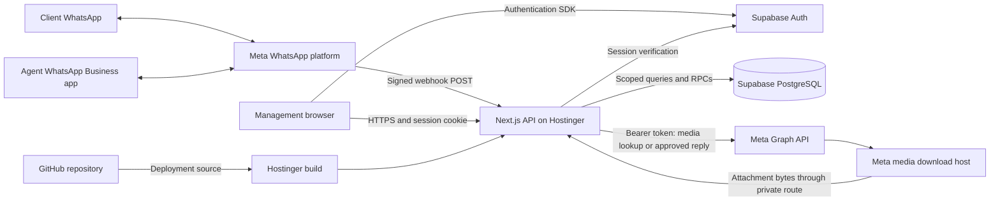
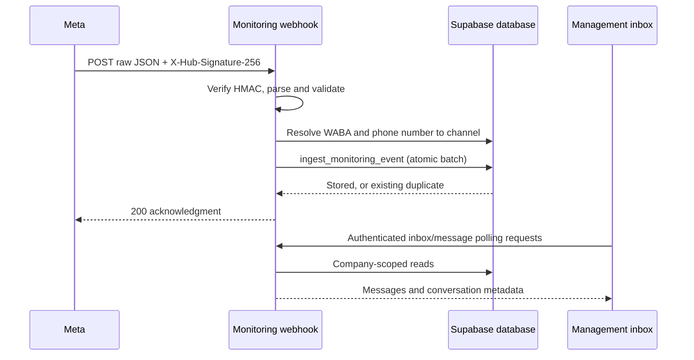
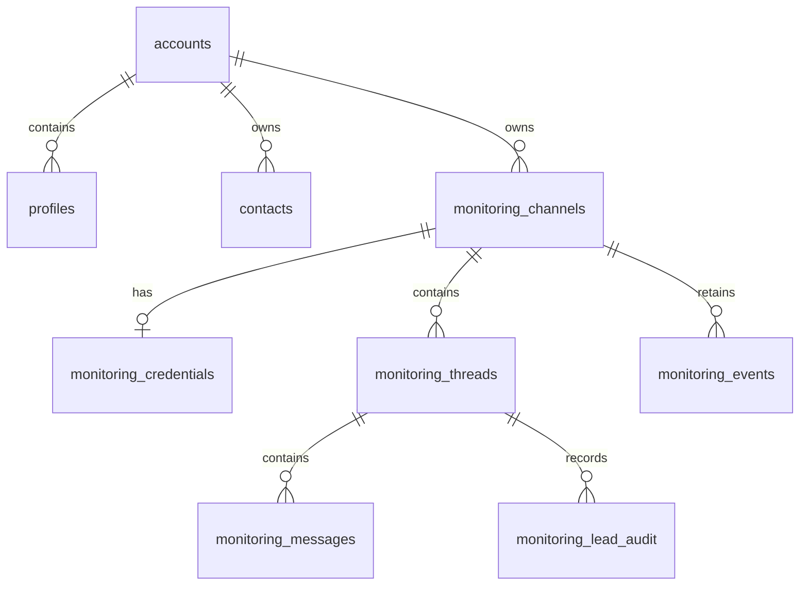

# Numera waCRM — architecture, operations and development handbook

**Prepared: 21 October 2026, Asia/Karachi.** This is an internal handover document for the Numera Digital CRM. It describes the inspected source tree, the project history available in this session, and the limits of what has been verified.

**Current code location:** `/workspace/WACRM` in the Codex cloud development environment. This is not a folder on your Mac. **GitHub:** <https://github.com/digitalnumera-lgtm/WACRM>. **Branch:** `main`. **Latest local committed revision at this handover:** `52e0a74`.

There are additional **uncommitted changes** for conversation tools, saved replies and Meta/media access recovery. They are in this workspace but are not included when someone clones only the committed GitHub version. No commit, push or deployment is performed as part of this documentation task.

The exact revision currently serving on Hostinger has not been independently checked during this handover. A passing local build, a GitHub commit, a Hostinger deployment and a published Meta app are four different things.

This document contains credential **names and handling instructions**, not live tokens, passwords, encryption keys or session cookies. Public project and asset IDs below identify resources; they do not grant access by themselves.

## Contents

1. [What we are building](#1-what-we-are-building)
2. [Where everything lives](#2-where-everything-lives)
3. [Architecture and connections](#3-architecture-and-connections)
4. [How messages, replies and media work](#4-how-messages-replies-and-media-work)
5. [Database structure](#5-database-structure)
6. [Meta accounts, app, tokens and onboarding](#6-meta-accounts-app-tokens-and-onboarding)
7. [Features and their actual status](#7-features-and-their-actual-status)
8. [Historical conversations and contacts](#8-historical-conversations-and-contacts)
9. [Code and file map](#9-code-and-file-map)
10. [API inventory](#10-api-inventory)
11. [Secrets and configuration](#11-secrets-and-configuration)
12. [VS Code and local development](#12-vs-code-and-local-development)
13. [Git, review and deployment workflow](#13-git-review-and-deployment-workflow)
14. [Hosting, domains and moving providers](#14-hosting-domains-and-moving-providers)
15. [Management operating guide](#15-management-operating-guide)
16. [Troubleshooting](#16-troubleshooting)
17. [Security, backups and maintenance](#17-security-backups-and-maintenance)
18. [Roadmap and acceptance criteria](#18-roadmap-and-acceptance-criteria)
19. [Evidence, limits and related documents](#19-evidence-limits-and-related-documents)

## 1. What we are building

### Purpose

Numera waCRM is a company-controlled web application where management can review client conversations across the company's WhatsApp business numbers. Agents keep using their existing WhatsApp Business phone apps. Owners and administrators can optionally reply from this CRM.

The requested experience is inspired by WabaCRM, respond.io and Chatwoot: a simple individual-conversation inbox, contacts, rich media, reports, number management, historical imports and useful management workflows. It is a tailored product, not a claim that every feature of those products has already been implemented.

The operating decisions already made are:

- Management uses the CRM; agents are not required to move their daily work into this application.
- Only owners/admins may send through the management reply endpoint.
- A workspace setting can disable management replies completely, including the composer and its reply-window notice.
- Incoming client messages and outgoing phone-app messages should appear together, grouped by business number and customer.
- Numbers can be added and reversibly removed from this CRM.
- History and media must be represented accurately. Missing content must not be invented or presented as successfully restored.
- Changes are developed and tested before publication. The present instruction is **do not commit yet**.

### The three similarly named systems

| Name | Meaning |
| --- | --- |
| Numera waCRM / this repository | Your customized application, its management interface and backend |
| waCRM in Meta Developers | Your Meta developer application that receives authorized webhook deliveries and supplies an app identity for API access |
| WabaCRM at `wabacrm.com` | A separate third-party service previously connected to some business numbers |

Granting the third-party WabaCRM partner access does not automatically grant your custom Meta app the same access. Connecting a number in your own CRM also does not copy that provider's database.

### Meaning of an “agent” here

In the current management inbox, the assigned-agent label comes from the **business channel label**, such as “Tahir”. It is not a complete conversation assignment system, nor proof that a corresponding CRM user exists. A client's conversations with Tahir's number and Ali's number remain separate threads.

## 2. Where everything lives

| Component | Current location or identifier | Responsibility / verification boundary |
| --- | --- | --- |
| Working source | `/workspace/WACRM` | Cloud development checkout, including pending edits |
| Git repository | `digitalnumera-lgtm/WACRM` on GitHub | Versioned source; does not store the live conversation database |
| Current branch / commit | `main` / `52e0a74` | Locally verified committed baseline; pending changes are separate |
| Hosting | Hostinger Node.js application | Runs the Next.js frontend and API server; exact live revision/plan not rechecked here |
| Last supplied application origin | `https://navajowhite-squirrel-888558.hostingersite.com` | Login, management UI and webhook origin shown by the user |
| Supabase project | `stvjblztwpohvatdalww` | PostgreSQL database and Supabase Auth |
| Supabase URL | `https://stvjblztwpohvatdalww.supabase.co` | Project API endpoint, not a credential |
| Meta developer app | `1121820883867005` | Custom waCRM app |
| Meta business portfolio | `1608291074028110` | Numera Digital asset ownership/access container |
| WhatsApp network / Cloud API | Meta | Message delivery, API authorization and temporary media availability |
| Optional future custom domain | `numeradigital.online` was discussed | Purchase, DNS and deployment on this name are not verified by this handover |
| Other earlier domain references | `crm.numeradigital.com` appears in older recovery notes | Treat as historical configuration information, not proof of the current canonical origin |

Your laptop, the cloud workspace, GitHub, Hostinger and Supabase are separate systems. Saving a file in one does not automatically update all the others.

### Important URLs

Use the **actual deployed HTTPS origin** in front of these paths:

| Path | Purpose |
| --- | --- |
| `/login` | Management sign-in |
| `/monitoring` | Main management workspace |
| `/monitoring?view=settings` | Workspace settings; the pending Meta renewal UI also links here |
| `/api/monitoring/webhook` | Meta webhook verification and event delivery |
| `/privacy` | Public privacy policy |
| `/data-deletion` | Public deletion-request instructions |
| `/auth/callback` | Supabase authentication/email-link callback |

## 3. Architecture and connections



### Responsibilities

**Next.js** serves the interface and the backend routes from the same application. A separate Express server is not required. React components render the inbox, contacts and controls. The browser calls same-origin `/api/monitoring/...` endpoints.

**Supabase Auth** verifies the signed-in manager. The backend loads that user's profile and account role before permitting management operations.

**Supabase PostgreSQL** stores channels, messages, threads, contacts, retained events, credentials in encrypted form, and management metadata. It is not stored inside the Git repository or the Hostinger source directory.

**Meta Graph API** is called by the server for number verification, portfolio discovery, media retrieval and authorized management replies. Meta access tokens stay on the server side of these calls.

**Meta webhooks** deliver new activity to the server. They are independent of a manager keeping a browser tab open. Receipt still depends on app publication/access, correct subscriptions, correct channel routing, a reachable server and successful database storage.

**GitHub/Hostinger integration** supplies application code to a deployment build. Whether a particular push automatically deploys depends on the configured Hostinger integration; confirm the selected repository and branch there.

### What is not currently in the management architecture

- No dedicated durable background-job queue for native history import or media archiving.
- No permanent attachment archive for the management media route.
- No continuously synchronized mirror of every phone contact and every historical conversation.
- No WebSocket subscription driving this management inbox: it currently uses polling and cursor requests.
- No working third-party WabaCRM API import connection. The implemented import path reads files.
- No verified integration with every channel advertised by respond.io or Chatwoot.

## 4. How messages, replies and media work

### 4.1 Login and company isolation

1. The manager opens `/login` and signs in through Supabase Auth.
2. The SSR integration maintains the session using cookies. Middleware preserves refreshed cookies across redirects.
3. A management API calls `requireRole('admin')`.
4. The server validates the user, looks up `profiles` by `user_id`, and obtains `account_id` and `account_role`.
5. The account must exist and the role must be owner or admin.
6. Queries are restricted to that account. Service-role operations additionally perform explicit account/channel/thread checks.

The account ID used for authorization is not accepted from an arbitrary browser field. An authenticated agent/viewer does not gain management access merely by opening a direct API URL.

### 4.2 Incoming client message



The webhook endpoint has two different jobs:

- **GET:** compare the webhook verify token and return Meta's verification challenge.
- **POST:** verify the HMAC SHA-256 signature of the raw body using the Meta app secret, then store the delivered events.

The POST body limit is 1 MiB. Invalid signatures are rejected before storage. Each change is mapped by WABA ID and, where present, phone number ID. A phone-specific event must have an unambiguous channel match.

The `ingest_monitoring_event` database function stores the event, messages and thread updates atomically for each batch. Stable event hashes and message identities make delivery retries idempotent. A failed storage operation returns 503 so Meta can retry; a successful earlier batch will deduplicate on that retry.

An inactive channel is intentionally skipped. An unknown channel is not automatically created from untrusted webhook content. An event without a phone ID is retained against appropriate configured WABA channels for review, without guessing a conversation.

### 4.3 Agent replies sent from the phone

The normal incoming `messages` field does not by itself supply all outgoing phone-app activity. The implementation recognizes **`smb_message_echoes`**, whose `message_echoes` entries describe phone-app replies. Their `to` value identifies the client, and they are stored as outbound messages.

This depends on the actual number's authorized WhatsApp Business App coexistence integration. Selecting a webhook field is not sufficient if the number/app is not eligible or properly connected. The user subsequently reported seeing both inbound and outbound messages; this does not establish that every number and every event type is complete.

Delivery/read status events are retained in the event ledger. A complete delivery-lifecycle model and accurate read/delivery analytics have not yet been integrated into the management inbox.

### 4.4 Management replies

1. The manager opens an existing conversation.
2. The reply-state endpoint checks the workspace switch, the channel and the local customer-service window.
3. The manager types text and explicitly sends it.
4. The server verifies owner/admin access, account ownership, an active channel, enabled management replies and reply-window eligibility.
5. A durable request ID is reserved in `monitoring_events` **before** contacting Meta.
6. The server decrypts the channel's token and submits a text message to `POST /v26.0/{phone_number_id}/messages`.
7. The result is recorded. An accepted message is ingested into the conversation.

Limits and behavior:

- Text only in the dedicated management composer; maximum 4,096 Unicode code points.
- The local eligibility check uses the latest eligible incoming customer message and a 24-hour window. Meta makes the final decision.
- Templates and outbound media are future management-composer work.
- Rate limiting currently permits 30 attempts per minute per account/user in a server process. This is not a distributed rate limiter.
- A repeated request ID with the same payload is checked against its recorded attempt. A conflicting payload is rejected.
- Timeout or malformed upstream response can leave an **uncertain** outcome. It is not safe to invent a new request and resend automatically.
- “Accepted by Meta” does not mean delivered or read by the client.
- The browser keeps an outstanding attempt ID/draft in session storage for recovery. Access tokens are not stored there.
- An accepted reply whose conversation write fails needs reconciliation; no automatic recovery worker has been completed for that case.

### 4.5 Media retrieval and the current failure

```mermaid
sequenceDiagram
  participant B as Browser
  participant A as Private media route
  participant D as Supabase
  participant G as Meta Graph API
  participant C as Meta CDN
  B->>A: GET /api/monitoring/messages/{id}/media
  A->>D: Check manager/account/message; read encrypted credential
  A->>A: Decrypt token on server
  A->>G: GET media ID with bearer token
  G-->>A: Fresh download URL and metadata
  A->>C: Authorized download from allowed host
  C-->>A: Media bytes
  A-->>B: Private media response / byte range
```

For management conversations, the database normally stores a **media ID**, not the attachment bytes. The API fetches the current download URL from Meta, retrieves the attachment, and returns it through an authenticated route. The browser does not receive the Meta bearer token or raw private download URL.

Images/stickers render directly; audio and video use native players; documents can be downloaded. Genuine captions remain, while synthetic titles such as `[audio message]` are suppressed by the renderer where appropriate.

The route checks ownership before credential use, restricts download hosts, rejects redirects, limits media to 32 MiB, uses timeouts, validates allowed MIME types and supports a single byte range for playback. Responses are private/no-store. Browser codec support can still prevent playback even if the server can retrieve the file.

**Latest diagnostic evidence from the preceding work:** sampled recent attachments across the five configured real channels were rejected by Meta with code 190; a phone lookup also returned subcode 467, indicating invalidated access. That points to rejected credentials, not proof that all the attachments have expired. No valid replacement token was available in that investigation, and production credentials were not changed.

The pending media-recovery changes add specific error categories, a Settings link, an authenticated diagnostic, download fallback, and a token-renewal form. They require deployment before appearing on the hosted application. A new valid token may restore access to files Meta still retains; it cannot recreate unavailable files.

### 4.6 Loading and scrolling

- The conversation list loads in batches of 30 with continuous downward scrolling.
- A conversation starts with the latest 50 stored messages. Scrolling upward requests earlier records and preserves the visible scroll position.
- Timestamp plus message ID cursors prevent ambiguous boundaries when multiple messages have the same timestamp.
- The visible chat polls for newer messages approximately every 15 seconds; workspace data refreshes approximately every 30 seconds while visible.
- Several recently opened conversations are retained in memory for quicker navigation. This cache is not a permanent chat backup.
- “Unlimited scrolling” means there is no fixed total inbox-message cutoff in the scrolling design. It does not mean unlimited database/storage quota or access to messages never imported.

## 5. Database structure

### 5.1 Main relationships



This diagram explains logical relationships; it is not a replacement for a complete audited SQL schema dump.

| Table | Important columns / purpose |
| --- | --- |
| `accounts` | Company ID, name, owner user ID, currency and timestamps |
| `profiles` | User ID, account ID, account role, name/email and profile fields |
| `contacts` | Account/user ownership, phone, normalized phone, name, email, company and WhatsApp identity fields |
| `monitoring_channels` | Account, WABA ID, phone number ID, display number, agent label, active flag and last-event timestamp |
| `monitoring_credentials` | `channel_id`, `encrypted_token`; deliberately separate from browser-visible channel records |
| `monitoring_threads` | Account/channel, customer number/name, lead status, latest message time/preview/direction and message count |
| `monitoring_messages` | Account/channel/thread, internal ID, Meta message ID, direction, sent time, kind, content, optional media ID and received time |
| `monitoring_events` | Account/channel, event hash, field, JSON payload, review flag and received time |
| `monitoring_lead_audit` | Account/thread, actor, previous/new lead status and timestamp |

An internal UUID, a Meta message ID, a phone number ID and a WABA ID are different identifiers. Substituting one for another can produce routing or authorization failures.

### 5.2 Database functions

| RPC | Purpose |
| --- | --- |
| `create_monitoring_channel` | Creates a channel with its encrypted credential using the existing database contract |
| `ingest_monitoring_event` | Atomically persists an event, message batch and conversation updates with duplicate protection |
| `set_monitoring_lead_status` | Changes lead status and records the authenticated actor in the audit trail |

RPC message arguments use `id`, `customer`, `name`, `direction`, `timestamp`, `kind`, `text`, and `media_id`. These names differ from physical message-table columns such as `meta_id`, `sent_at` and `content`.

### 5.3 Management metadata in the event ledger

The inspected recovered `accounts` table has no general settings JSON column. Rather than replay unrelated migrations, the current implementation stores a small set of company-scoped management records in the existing private event ledger:

| Event field | Status | Purpose |
| --- | --- | --- |
| `management_settings` | Committed | Workspace management-reply switch and actor/time |
| `management_reply` | Committed | Durable outbound request reservation and result state |
| `management_reply_result` | Committed | Accepted send ingestion metadata |
| `management_thread_status` | Pending changes | Open/resolved/snoozed state and observed message count |
| `management_thread_read` | Pending changes | Shared CRM read marker or explicit unread flag |
| `management_note` | Pending changes | Private management note and author |
| `management_quick_reply` | Pending changes | Saved reply title/body, version and soft-delete state |

The new status/read/note/snippet records have `needs_review=false`; they are not unsupported WhatsApp messages. Status and read records have separate deterministic IDs. Notes and saved-reply creation use request IDs; saved-reply edits check versions to reject conflicting updates.

`monitoring_events.channel_id` is required. Workspace-level settings/snippets use an existing channel as their database anchor. This is one reason channel removal is reversible rather than a hard row deletion. Before introducing hard deletion or a dedicated settings table, design the data migration and referential behavior explicitly.

### 5.4 Schema and migration warning specific to this project

The code was recovered/customized against an existing Supabase project. The repository contains an upstream migration sequence, while older recovery evidence reported a different applied migration ledger. Some schema/catalog inspection was limited by management-token permissions.

**Do not reset production or blindly replay every file under `supabase/migrations`.** A clean upstream database is not proven to reproduce the custom monitoring schema and RPC contracts used by this installation.

The GitHub migration workflow tests a disposable local database. It does not migrate the production Supabase project. To create a faithful staging environment, first obtain and compare the actual schema, policies, functions and migration ledger; then restore an authorized schema copy with sanitized fixtures.

## 6. Meta accounts, app, tokens and onboarding

### 6.1 Meta hierarchy

1. **Business portfolio:** Numera's organization and owned business assets.
2. **WhatsApp Business Account (WABA):** the WhatsApp business asset under that portfolio.
3. **Phone number asset:** the actual agent/business number with its own phone number ID.
4. **Developer app:** the integration identity, permissions, app secret and webhook configuration.
5. **User/system-user authorization:** gives a token permission to access specified assets.
6. **Provider/coexistence setup:** determines whether phone-app activity and eligible history can be shared with the integration.
7. **CRM channel record:** maps a Meta WABA and phone number ID to the company's inbox and credential.

Every required layer must agree. An app being published does not fix an invalid token. A valid token does not create a CRM channel. A connected channel does not guarantee history import.

### 6.2 Known asset mapping from the setup work

These are identifiers previously established during setup, not a fresh live asset-access audit:

| Agent label | WABA ID | Phone number ID |
| --- | --- | --- |
| Iqra Tanveer | `1602716004767989` | `1356625934195218` |
| Ali Anwar | `1192605976360851` | `1334421996415091` |
| Ahmad | `1085789333949879` | `1345901911941405` |
| Somia | `1050849214264195` | `1295201607007861` |
| Tahir | `3184093921786214` | `1286834291186944` |

Tahir's confirmed displayed number was `+92 337 4066150`. Usman's WABA `113549214672032` was also mentioned but should not be assumed to belong to this five-channel configuration without checking.

The earlier US number `+1 555 662 4452` was Meta's **test number**, associated with test WABA `1637465364555464` and phone ID `1337694306097752`. Changing a label to “Ahmed” cannot turn that test asset into a real agent number.

### 6.3 Where to find the app and use case

Open the app dashboard directly:

<https://developers.facebook.com/apps/1121820883867005/dashboard/>

In that app, open **Use cases**, then the WhatsApp use case whose full label in the supplied screenshots was **Connect with customers through WhatsApp**. Within its customization screen, Meta used the shorter **Connect on WhatsApp** label. These are app navigation items, not a phrase to search in Meta's documentation search bar.

Meta changes menu wording. Use the app ID, WhatsApp use case and actual asset IDs to orient yourself rather than relying only on a shortened label.

### 6.4 Configuration checklist and meaning

| Item | What it establishes |
| --- | --- |
| App publication | Eligibility for production delivery under the warning shown in this app's dashboard; user reported publishing it |
| Privacy and deletion URLs | Public policy/instructions required by app setup; do not grant API access |
| Business verification | Business identity status; not equivalent to all permissions being approved |
| App Review / access level | Determines permission eligibility for a particular use case; do not infer a requirement from another app's workflow |
| WABA authorization | App/user/system-user permission to the selected accounts |
| Webhook callback | Where Meta sends signed activity |
| Verify token | Shared verification string for the callback challenge |
| App secret | Validates that webhook POSTs came with a valid Meta app signature |
| Bearer access token | Authorizes outbound API calls such as number lookup, media fetch and sending |
| `messages` subscription | Incoming messages and delivery/status activity |
| `smb_message_echoes` subscription | Phone-app outgoing messages for eligible coexistence connections |
| CRM channel mapping | Routes that number's events to the right company's conversation data |

The Tech Provider dialog shown earlier described a potentially irreversible status change. Do not enroll solely to get past an unrelated error. Whether a native coexistence/onboarding route requires Tech Provider or partner status must be assessed for this app and integration model.

### 6.5 Adding a number in this CRM

The current portfolio picker reads `/{business_id}/owned_whatsapp_business_accounts` and each WABA's `/phone_numbers` through Graph API v26.0. It can use a supplied token or reuse a saved credential from the manager's own active channels.

After selecting a number, the channel endpoint verifies the phone and its WABA membership, encrypts the token and calls `create_monitoring_channel`. This adds the number to **your database**. The endpoint does not register/migrate the phone, remove a provider, or automatically subscribe the app to that WABA.

Adding an already-configured number returns a conflict. Restoring an existing removed channel is different from adding it again. The intended future onboarding flow should combine eligible Meta authorization with clear CRM connection status, while preserving working providers.

### 6.6 Renewing access

Use a token issued for the company's own app with the intended business assets assigned. Relevant permissions are `whatsapp_business_management` and `whatsapp_business_messaging`; portfolio discovery additionally needs appropriate `business_management` access.

A system-user token can reduce dependence on a person's temporary login session where that option is available. It still can be revoked or lose asset access. The label “permanent token” should not be interpreted as guaranteed forever.

The pending **Settings → Meta access** feature:

1. Accepts a new token through a password input and selected existing numbers.
2. Checks that every selected channel belongs to the signed-in manager's company.
3. Verifies all selected phones against their stored WABAs through read-only Meta requests.
4. Writes encrypted credentials in one database statement only after every selected number verifies.
5. Leaves credentials unchanged when verification fails.

It does not generate a Meta token, change provider subscriptions, activate inactive channels or recover media that Meta no longer has.

## 7. Features and their actual status

**Committed** means included in the source baseline through `52e0a74`; it does not assert that the hosted deployment has that exact revision. **Pending** means implemented in the current working tree but uncommitted. **Planned** means still requires work. **Legacy** means upstream code exists, but that is not evidence it works in this management product.

| Capability | Status | Scope / limitation |
| --- | --- | --- |
| Management dashboard | Committed | Counts CRM-stored conversations, inbound/outbound messages and channel rows |
| Individual conversation inbox | Committed | Split layout, search, number/label/lead filters and mobile navigation |
| Continuous chat/list scrolling | Committed | Cursor batches, earlier messages on upward scroll, in-memory recent-chat cache |
| Phone-app outgoing messages | Committed | Handles eligible `smb_message_echoes` deliveries |
| Message colors and date separators | Committed | Visual distinction between client and business messages |
| Images, audio, video, stickers | Committed | Private Meta retrieval; no durable archive |
| Documents | Committed | Authenticated download; not a universal document-preview engine |
| Reactions / emoji / structured messages | Partial, committed | Readable known formats and available target context; not every Meta format or cross-page reaction state |
| Lead stages and audit | Committed | New, contacted, qualified, won, lost; records status changes |
| Contacts | Committed | Searchable combined directory and chat participants, file import and chat links |
| History CSV/JSON import | Committed | Explicit per-number import with validation and duplicate protection |
| Native Meta history/contact ingestion | Planned | Retaining events is not the completed import pipeline |
| Portfolio discovery / manual number add | Committed | Read-only Meta validation and encrypted credential storage |
| Number pause/remove/restore | Committed | Reversible activation flag, preserves stored data |
| Management text replies | Committed | Owner/admin only, window checks, durable request IDs |
| Reply enable/disable setting | Committed | Hides composer and blocks send server-side; inbound monitoring continues |
| Message logs | Committed | Stored-body search, filters, page export |
| Media library | Committed | Search and view available media; requires valid media IDs/access |
| Activity reports | Committed | 7/30/90-day UTC views, bounded result set and explicit partial-data notice |
| Conversation open/resolved/snoozed | Pending | Count-based reopening and snooze expiry; not a full rules engine |
| Shared CRM read/unread markers | Pending | Company-shared review state, not WhatsApp read receipts |
| Internal notes | Pending | Private, immutable, paginated notes; never sent to WhatsApp |
| Saved text replies | Pending | Create/search/edit/remove, variable insertion and conflict checks |
| Meta credential renewal UI | Pending | Verify selected numbers then replace encrypted credentials |
| Specific media errors and recovery | Pending | Token/permissions/network/type/size diagnosis and recovery actions |
| Global open/unread queues and saved views | Planned | Per-thread metadata exists in pending work; full list filters do not |
| Full contact editing, tags, custom fields, merges | Planned management integration | Some legacy infrastructure exists |
| Management attachments/templates sending | Planned | Not enabled by the text composer |
| Campaigns, bots, automated replies | Legacy, sending blocked | Must be intentionally designed and tested before activation |
| Sales pipelines, team assignment | Legacy / partial | Not unified with the management channel/thread model |
| AI assistant / knowledge base | Legacy, API blocked | No active management AI feature is established |
| Messenger, Instagram, email, calls | Not established | No verified production integration in this management workspace |
| Native mobile app | Not implemented here | Responsive web UI; the third-party WabaCRM Android app is separate |

### 7.1 Enabled and disabled controls

`NUMERA_MONITORING_ONLY` defaults to enabled unless its value is exactly `false`. Keep it `true` for this product's current operating model.

The policy blocks these legacy page prefixes: `/inbox`, `/broadcasts`, `/automations`, `/flows`, `/agents`. It blocks these API prefixes: `/api/whatsapp`, `/api/ai`, `/api/automations`, `/api/flows`, `/api/v1`. Legacy transport boundaries also guard operational sends.

The dedicated `/api/monitoring/...` routes remain available under their own authentication and authorization checks. The management text sender is an explicitly scoped capability; it does not require disabling the monitoring policy.

This policy is not a statement that every legacy route is disabled. Other upstream routes exist and should be assessed before expanding access. The management pages should be the supported entry point for this installation.

The management-reply setting defaults to enabled when no settings row exists; read failures block sending. A channel must exist to persist the workspace setting using the present schema. Disabling replies does not disable inbound events, phone replies, media reading or private notes.

### 7.2 Pending conversation tools in detail

- **Resolved/snoozed:** store the message count observed when the action is taken. A later stored message reopens the thread; that includes phone replies or imported history, not only new client messages. Snooze expiry is evaluated from timestamps, without a dedicated scheduled worker.
- **Read/unread:** shared among management users. Opening a chat does not automatically mark it read in the pending implementation; use the explicit control. Observed counts avoid marking newly arrived unseen messages as already read.
- **Notes:** management-only records, with author and timestamp. They remain available when sending is disabled. They are not editable WhatsApp messages.
- **Saved replies:** text snippets with `{{name}}`, `{{phone}}` and `{{agent}}` substitutions. Insertion fills/appends a draft; the manager must still send. They are not approved Meta message templates and do not bypass the customer reply window.
- **Limits:** snippets show up to 100 search matches; notes use pagination. Global queue filters, attachment snippets and full workflow audits remain future work.

## 8. Historical conversations and contacts

### Why an empty inbox can coexist with a connected Meta account

The CRM can display messages it has stored. Authorizing assets or publishing an app does not instruct Meta to replay every previous conversation. The phone, a previous provider and your own database may each hold different subsets of data.

There is no general Cloud API endpoint that retrieves the complete lifetime conversation history of any authorized number. A contact export contains contacts, not chat transcripts. A message-log CSV may contain message text and timestamps without attachment IDs or file bytes.

### Implemented file import

Choose one business number, then import JSON records or CSV columns:

```text
id,customer,name,direction,timestamp,kind,text,media_id
```

Example using fictional data:

```csv
id,customer,name,direction,timestamp,kind,text,media_id
example-message-001,15550001234,Example Client,inbound,2026-10-20T10:00:00+05:00,text,Please share the details,
example-message-002,15550001234,Example Client,outbound,2026-10-20T10:02:00+05:00,text,I will send the details shortly,
```

Rules:

1. `customer` must be an international phone number.
2. Direction is `inbound` or `outbound`; ambiguous labels require mapping before import.
3. Timestamps must include an explicit timezone. Preserve original times rather than making old messages look new.
4. Preserve real message IDs when available. Deterministic fallback IDs deduplicate repeated imports of the same source, but cannot reliably match an independently delivered live message with a different ID.
5. `media_id` is an optional Meta media ID. A URL, local filename or `[audio message]` placeholder is not an attachment.
6. Files are limited to 5 MB and 20,000 rows, submitted in batches of 200. Validate before importing.
7. A failed later batch does not undo earlier successful batches. Retrying the same correctly identified records is designed to deduplicate them.
8. Imports do not send messages to clients.

Contact imports use `phone,name,email` and preserve existing normalized-phone matches. The previously supplied WabaCRM contact CSV and message-log CSV were different exports. Importing one cannot replace the other. The earlier imported message export covered Ali's records; it did not prove every agent's full history had been restored.

### Native Meta coexistence history: separate unfinished work

Meta documents an eligible WhatsApp Business App onboarding/history-sharing flow with phone consent and bounded historical coverage. Earlier documentation review for this project described up to 180 days of individual-chat history, narrower media availability, and an onboarding-related request window. These are eligibility-dependent limits, not a guarantee for this app; recheck the current Meta documentation before implementing the flow.

The missing implementation includes eligible Embedded Signup, server-side code exchange, authorization/subscription verification, history/contact event parsing, a durable queue, chunk tracking, idempotent ingestion, progress/resume and media archival.

The current webhook retains unsupported/history payloads for review. That is useful evidence, but it is not a completed history importer. Do not disconnect a functioning provider merely to try to force a fresh import.

Official reference: <https://developers.facebook.com/docs/whatsapp/embedded-signup/custom-flows/onboarding-business-app-users>

## 9. Code and file map

```text
WACRM/
├── src/
│   ├── app/
│   │   ├── (auth)/                    Login, signup and password recovery
│   │   ├── (monitoring)/monitoring/   Management entry page
│   │   ├── (legal)/                  Privacy and deletion instructions
│   │   ├── (dashboard)/              Upstream dashboard/operational UI
│   │   ├── api/monitoring/           Current management backend
│   │   ├── api/whatsapp/             Legacy WhatsApp operations
│   │   ├── api/ai/, automations/, flows/, v1/
│   │   └── auth/callback/            Auth link handling
│   ├── components/monitoring/        Management UI components
│   ├── lib/monitoring/               Management domain logic
│   ├── lib/auth/                     User/account/role checks
│   ├── lib/supabase/                 Browser and server DB clients
│   ├── lib/whatsapp/                 Graph helpers, crypto and signatures
│   ├── lib/ai/, automations/, flows/ Upstream capabilities
│   └── middleware.ts                Session handling and route restrictions
├── supabase/migrations/              Upstream SQL history; see schema caution
├── supabase/ci/                      Disposable schema-check assertions
├── scripts/                         Build, standalone packaging, inspection
├── docs/                            Operational and technical documents
├── public/                          Static public assets
├── mcp-server/                      Separate upstream MCP integration code
├── .github/workflows/               CI and disposable migration testing
├── package.json / package-lock.json  Runtime scripts and dependency versions
├── next.config.ts                   Standalone build, headers and worker limits
├── .env.local.example               Configuration template, no real credentials
└── .gitignore                       Excludes local secrets/build/dependencies
```

### Files you will edit most often

| Change | Main source locations |
| --- | --- |
| Main management layout/navigation | `src/components/monitoring/workspace.tsx` |
| Individual conversation rendering | `src/components/monitoring/conversation.tsx` |
| Attachment display/errors | `src/components/monitoring/message-media.tsx` |
| Reply composer | `src/components/monitoring/reply-composer.tsx` |
| Pending notes/status controls | `src/components/monitoring/conversation-tools.tsx` |
| Pending saved reply interface | `src/components/monitoring/quick-replies.tsx` |
| Pending token-renewal interface | `src/components/monitoring/renew-access.tsx` |
| Webhook verification and responses | `src/app/api/monitoring/webhook/route.ts` |
| Event normalization and routing | `src/lib/monitoring/events.ts`, `ingest.ts` |
| Media fetch and error classification | `src/lib/monitoring/media.ts`, `media-errors.ts` |
| Send safety and transport | `src/lib/monitoring/management-reply.ts`, `management-transport.ts` |
| History parsing and validation | `src/lib/monitoring/import-file.ts`, `history-import.ts` |
| Role checks | `src/lib/auth/account.ts`, `roles.ts` |
| Credential encryption | `src/lib/whatsapp/encryption.ts` |
| Monitoring policy | `src/lib/monitoring/policy.ts` |
| Workspace reply setting | `src/lib/monitoring/settings.ts` |
| Pending management metadata | `src/lib/monitoring/workflow.ts`, `workflow-types.ts` |

A `*.test.ts` file checks behavior; a `route.ts` file defines an HTTP endpoint; a React `*.tsx` file renders UI. Route-group directories such as `(monitoring)` organize source and do not appear in URLs.

Do not edit `.next` or `node_modules` as application source. Those directories are generated and will be replaced.

## 10. API inventory

Except the webhook, these management endpoints require the authenticated owner/admin account context. Responses use private/no-store behavior. JSON writes validate input and origin where provided; IDs are validated before use.

| Endpoint, relative to `/api/monitoring` | Methods | Purpose |
| --- | --- | --- |
| `/` | GET | Channels, filtered conversation list and pagination/cursors |
| `/summary` | GET | Stored-data dashboard counts |
| `/threads/{id}` | GET, PATCH | Conversation/messages/audit; lead-status changes |
| `/threads/{id}/reply` | GET, POST | Reply eligibility/attempt status and management text sending |
| `/channels` | POST | Verify and add a business channel |
| `/channels/{id}` | PATCH | Activate/deactivate; not hard deletion |
| `/portfolio` | POST | Read Meta portfolio/WABA/phone assets; token stays out of URL |
| `/contacts` | GET, POST | Combined directory and batched contact import |
| `/import` | POST | Validate/import historical records for one channel |
| `/messages` | GET | Message-log and media-library queries |
| `/messages/{id}/media` | GET | Authorized attachment bytes/ranges; pending diagnostic mode |
| `/reports` | GET | 7/30/90-day UTC activity aggregation |
| `/events` | GET | Retained-event review listing |
| `/events/{id}` | GET | Account-scoped retained event detail |
| `/settings` | GET, PATCH | Management reply setting |
| `/access` | POST, pending | Verify and renew selected channels' encrypted Meta credentials |
| `/workflow` | GET, pending | Batched thread status/read metadata |
| `/threads/{id}/workflow` | PATCH, pending | Status/snooze/read changes |
| `/threads/{id}/notes` | GET, POST, pending | Private notes with cursor pagination |
| `/quick-replies` | GET, POST, PATCH, pending | Search/create/edit/soft-delete saved text replies |
| `/webhook` | GET, POST | Challenge verification and signed Meta delivery; no browser login |

### External service APIs actually involved

| Service/API | Used for |
| --- | --- |
| Supabase Auth | Sign-in, session validation and email-link recovery |
| Supabase PostgREST and RPC | Company-scoped database access and atomic functions |
| Graph API v26.0 business/WABA/phone GETs | Discover and verify authorized business numbers |
| Graph API v26.0 media GET | Resolve an attachment's current download metadata |
| Meta media hosts | Authorized attachment download |
| Graph API v26.0 phone `/messages` POST | Dedicated management text replies |
| Supabase management API | Optional setup/schema inspection script; not normal inbox traffic |
| GitHub and Hostinger build integration | Source delivery/build, not chat transport |

The upstream public API and MCP server are separate components. Their files and documentation do not mean they are deployed or enabled for this management application. The `/api/v1` prefix is blocked under the current policy.

## 11. Secrets and configuration

### 11.1 Credential inventory

| Name / item | Secret? | Where it belongs | Purpose and renewal implications |
| --- | --- | --- | --- |
| `NEXT_PUBLIC_SUPABASE_URL` | No | Local env / host build configuration | Chooses the Supabase project |
| `NEXT_PUBLIC_SUPABASE_ANON_KEY` | Public client key | Local env / host build configuration | Client/SSR project access; security depends on auth and database policies |
| `SUPABASE_SERVICE_ROLE_KEY` | Yes, powerful | Server-only env | Administrative DB operations; bypasses RLS, so explicit server scoping is essential |
| `ENCRYPTION_KEY` | Yes | Server-only env and separate secure backup | Original 32-byte key represented as 64 hex characters; decrypts existing channel credentials |
| `META_APP_SECRET` | Yes | Server-only env | Verifies webhook POST signatures for the custom Meta app |
| `META_MONITORING_VERIFY_TOKEN` | Yes | Server-only env and matching Meta webhook field | Validates webhook setup challenge; not an API bearer token |
| Per-channel Meta access token | Yes | Entered through authorized server flow; encrypted in `monitoring_credentials` | API/media/send authorization; renew when invalidated or permissions change |
| `META_ACCESS_TOKEN` | Yes if present in an operations environment | Secure diagnostic/setup environment only as needed | Was available during diagnosis; the management runtime reads per-channel DB credentials, not this variable as a global fallback |
| `META_APP_ID` | No | Only where relevant legacy/integration setup needs it | App identifier; not required by the dedicated webhook to verify signatures |
| `NEXT_PUBLIC_SITE_URL` | No | Environment | Canonical origin for relevant URL generation/origin validation |
| `NUMERA_MONITORING_ONLY` | No | Server env | Keep `true`; blocks legacy operational features |
| `NEXT_PUBLIC_APP_LOCALE` | No | Build environment | UI locale; default `en` |
| `SUPABASE_ACCESS_TOKEN` | Yes | Setup/inspection environment | Supabase management API; not needed for ordinary CRM runtime |
| GitHub login/PAT/deploy authorization | Yes | Git credential manager or platform integration | Repository access; never insert a token into the documented remote URL |
| Hostinger credentials/deploy authorization | Yes | Hostinger account/integration | Hosting management; not an app frontend variable |
| Supabase session cookies / user passwords | Yes | Auth/session system | End-user authentication; not repository configuration |

Encryption uses AES-256-GCM for new credentials, with legacy CBC decryption compatibility. The encrypted value contains an IV, ciphertext and authentication tag. Encryption is not permission: a server must still authorize the channel before decrypting its token.

**Do not replace the original encryption key as a routine token fix.** A new key cannot decrypt previously stored tokens. A deliberate key rotation needs a controlled decrypt/re-encrypt migration and a tested recovery plan.

### 11.2 Other configuration names in the source

`ALLOWED_INVITE_HOSTS` controls optional invitation hosts. `AUTOMATION_CRON_SECRET`, `AI_CONTEXT_MESSAGE_LIMIT`, `AI_REQUEST_TIMEOUT_MS` and `WHATSAPP_TEMPLATES_DRY_RUN` belong to upstream capabilities; their presence in code does not enable those capabilities in the management product. `ALLOWED_DEV_ORIGINS` concerns development origins. `HOSTNAME` and `PORT` control server binding. `NODE_USE_ENV_PROXY` concerns this cloud environment's network proxy.

There is no claim here that GitHub Actions secret settings, Hostinger secret settings or every optional upstream provider key have been audited. Their live values are intentionally excluded.

### 11.3 Git and secrets

`.gitignore` excludes `.env*`, with explicit exceptions for example templates. It also excludes `node_modules`, `.next`, build output, logs and common local files.

Ignoring a file does not remove a secret already committed in an older revision. Before committing, review the staged diff and filenames. If a real credential is committed, rotate it and assess history cleanup separately; deleting the visible line alone does not revoke it.

Never use the `NEXT_PUBLIC_` prefix for service-role keys, Meta tokens, app secrets or encryption keys. Next.js can embed public-prefixed values in browser assets. Changes to public build values normally require a rebuild.

### 11.4 Backup location versus documentation

Store real credentials in a password manager or managed secret store with access limited to maintainers. Maintain an independent secure copy of the encryption key and service configuration. A database backup containing encrypted tokens is insufficient to decrypt them if the key is lost.

This handbook is a credential map, not a secret backup. Source archives and patches accompanying it exclude live `.env` files and database exports.

## 12. VS Code and local development

### 12.1 Yes: you can develop on your own computer

You can run the Next.js application on your Mac, edit it in VS Code, inspect changes at `http://localhost:3000`, and commit/push only when ready. Saving a React component normally refreshes the development page automatically. You do not need a Hostinger deployment for every UI edit.

The current `/workspace/WACRM` path belongs to this cloud session. GitHub holds the committed baseline. To continue the latest work on your laptop, use the handoff patch as well as the repository clone.

### 12.2 Install the tools

Install Git, VS Code, and a supported Node.js version. Node 24 was used for the current workspace checks. The package declares Node `>=20`, and the repository CI currently uses Node 20. Use one tested version consistently for development and deployment; retain `package-lock.json`.

Check the installation:

```sh
git --version
node --version
npm --version
```

In VS Code, the `code` command is optional. If unavailable, choose **File → Open Folder** instead.

### 12.3 Clone the committed project

In a terminal on your Mac:

```sh
mkdir -p ~/Projects
cd ~/Projects
git clone https://github.com/digitalnumera-lgtm/WACRM.git
cd WACRM
git switch -c work/numera-crm
code .
```

Authenticate to GitHub using your normal credential manager if the repository requires it. Do not paste a token into the clone URL.

At this point you have the code GitHub knows about, not automatically this session's pending changes.

### 12.4 Bring across the pending edits

The handoff includes `numera-pending-changes.patch`, based on the full commit recorded in its companion handoff README. It contains tracked-file edits and intentional new files, including this handbook. On a clean checkout of that baseline, run:

```sh
git status --short
git apply --check /path/to/numera-pending-changes.patch
git apply /path/to/numera-pending-changes.patch
git status --short
```

The patch applies working-tree changes without committing them. If GitHub has advanced or you have local edits, do not force the patch over them. Use a separate branch at the documented baseline or resolve the differences deliberately.

The source ZIP is a convenient complete file snapshot, but excludes `.git`. Prefer clone plus patch when you want to retain normal Git history. Neither artifact includes dependencies, build output, live secrets or chat database contents.

### 12.5 Configure local environment

Create `.env.local` in the repository root. The existing `.env.local.example` is a starting point, but the management-specific variables below also matter. Replace placeholders privately:

```dotenv
NEXT_PUBLIC_SUPABASE_URL=https://YOUR_DEVELOPMENT_PROJECT.supabase.co
NEXT_PUBLIC_SUPABASE_ANON_KEY=YOUR_DEVELOPMENT_PUBLIC_KEY
SUPABASE_SERVICE_ROLE_KEY=YOUR_DEVELOPMENT_SERVER_KEY
NEXT_PUBLIC_SITE_URL=http://localhost:3000
NUMERA_MONITORING_ONLY=true
ENCRYPTION_KEY=YOUR_DEVELOPMENT_64_HEX_CHARACTER_KEY
META_APP_SECRET=YOUR_DEVELOPMENT_META_APP_SECRET
META_MONITORING_VERIFY_TOKEN=YOUR_DEVELOPMENT_WEBHOOK_VERIFY_TOKEN
NEXT_PUBLIC_APP_LOCALE=en
```

These are placeholders, not usable credentials. Never commit the completed file.

**Local frontend does not mean local data.** If you point this file at production Supabase, local actions can change production records, settings, contacts and credentials, and an authorized reply can send a real message. There is currently no universal “local dry run” switch for all management actions.

The recommended development setup is a separate Supabase project with the verified custom schema and synthetic data, plus test Meta assets when needed. A clean replay of the upstream migration folder alone is not yet a verified setup for this recovered monitoring installation. Establish that schema handoff before relying on a new project.

For an existing DB containing encrypted credentials, the matching original encryption key is required. For an isolated fresh staging DB, use a distinct development key and development credentials. Do not mix project URL, anon key and service-role key from different projects.

### 12.6 Run the application

```sh
npm ci
npm run dev
```

Open `http://localhost:3000/login`. Sign in using a user in the configured Supabase project whose profile belongs to an account with owner/admin access. A user from another Supabase project will not automatically work here.

For confirmation/reset links, add `http://localhost:3000/**` to the chosen project's allowed auth redirect URLs. Keep production's canonical Site URL appropriate to production; do not change it to localhost merely to develop. See [auth-emails.md](auth-emails.md).

Stop the dev server with Ctrl+C. Restart after environment changes. Do not run development and production-preview servers on the same port simultaneously.

### 12.7 Test the production build locally

```sh
npm run typecheck
npm run lint
npm test -- --maxWorkers=4
npm run build
HOSTNAME=127.0.0.1 PORT=3000 npm start
```

`npm run build` also runs the postbuild packaging step. `npm start` runs `.next/standalone/server.js`; it requires a successful build first. To use another port, change `PORT` and the local site/redirect configuration as appropriate.

The `HOSTNAME=... PORT=...` syntax above is for macOS/Linux shells. In PowerShell set `$env:HOSTNAME` and `$env:PORT` before `npm start`.

This managed cloud environment needs `NODE_USE_ENV_PROXY=1` for certain Node network requests. A normal home/office Mac usually does not need that variable. Preserve TLS certificate verification; do not disable it to solve connection problems.

### 12.8 Local Meta/webhook testing

Meta cannot deliver to your laptop's `localhost` address over the public internet. Ordinary UI development can read a staging database without changing the production webhook.

To test real webhook delivery locally, use a dedicated test app/number with an HTTPS tunnel to a test server, configure the matching callback/verify token/app secret, and keep the production callback intact. A tunnel alone does not provide Meta asset authorization. Signed synthetic fixtures against an isolated test database are another option for parser and storage tests.

Do not switch the working production callback to your laptop just to inspect a layout change. Stopping the laptop server would interrupt that delivery path.

## 13. Git, review and deployment workflow

### 13.1 The sequence

```mermaid
flowchart LR
  Edit[Edit in VS Code] --> Local[Run locally]
  Local --> Checks[Tests, typecheck, lint and build]
  Checks --> Review[Review diff and secrets]
  Review --> Commit[Commit on work branch]
  Commit --> Push[Push to GitHub]
  Push --> Merge[Review and merge deployment branch]
  Merge --> Deploy[Hostinger build and deploy]
  Deploy --> Verify[Verify live revision and behavior]
```



- **Save:** changes files on the current computer.
- **Commit:** records a version in that checkout's Git history.
- **Push:** uploads commits to GitHub.
- **Deploy:** builds/runs a selected version on hosting.
- **Meta publish:** changes the Meta app's publication status; independent of all the above.

### 13.2 Current source history

| Commit | Delivered source change |
| --- | --- |
| `ee6cbf7` | Public privacy/deletion pages |
| `11cea59` | Private image/audio/video playback |
| `6905930` | Redundant audio-placeholder removal |
| `e59a9c5` | History/contact imports, portfolio discovery, rich-message support |
| `13dc8a4` | Management dashboard, contacts and split inbox |
| `9c6c013` | Logs, media library and activity reports |
| `e72f1c7` | Management text replies with duplicate protection |
| `38294f5` | Hostinger build worker limits |
| `a2800bc` | Simpler inbox and reversible number removal |
| `6353aec` | Continuous scrolling and cached chat navigation |
| `52e0a74` | Management reply enable/disable setting |

The earlier recovery document mentions a `recovery/wacrm` branch and unavailable original artifacts. That is historical context. The inspected current working branch is `main`; do not assume the original missing source archives were recovered.

Package metadata still names upstream `ArnasDon/wacrm`. The actual Git remote is Numera's repository. Preserve license/attribution when maintaining the fork; do not mistake upstream metadata for the deployment repository.

### 13.3 Review before committing

```sh
git status --short
git diff --stat
git diff
```

Review intentional new files too; ordinary `git diff` does not show untracked file contents. Stage the intended paths after inspection, then inspect the staged result:

```sh
git add path/to/reviewed-file
git diff --cached --stat
git diff --cached
```

When you decide the work is ready, commit and push the feature branch. This documentation task does not perform those actions. Prefer a reviewed merge into the hosting branch rather than assuming every experiment should go straight to `main`.

### 13.4 CI and deployment

`.github/workflows/ci.yml` runs install, lint, typecheck, tests and build on configured pushes/PRs. It uses dummy configuration for build/test checks, not production credentials. It does not establish live Meta access.

`.github/workflows/migrations.yml` starts disposable Postgres and tests migration replay/schema assertions for relevant changes. Its local database reset is confined to that CI environment. Do not translate it into a reset of the existing hosted database.

Hostinger should build with `npm run build` and start with `npm start`, using the correct app environment. The build caps native worker pools and Next build CPUs at two to avoid the earlier thread-quota failure. The standalone postbuild step copies static assets and `public` into the server output.

After a deployment, verify the selected commit, successful startup, login, inbox access, known recent conversation, media with valid credentials, settings behavior, and webhook storage. A generic “Ready” log only says the Node process started.

### 13.5 Rollback

Record the previously working deployment revision and environment before promotion. For a code-only change, redeploy that known revision if necessary. Do not reset the database to fix a UI regression.

If a release changes schema or data semantics, rollback requires a separate compatible data plan. Preserve the encryption key across hosting rebuilds and rollbacks. Never assume an older build can read a new schema without checking.

## 14. Hosting, domains and moving providers

### 14.1 What Hostinger stores

The Node hosting runtime holds application/build files, dependencies/runtime resources and transient working memory/files. It runs your server. The management chat records live in Supabase; current management attachments are fetched from Meta.

Hostinger disk capacity does not automatically make attachment storage persistent. Deployments may replace application directories; plan-specific durable volumes, permissions, backup and access behavior must be verified before designing filesystem storage.

For durable media, a private object store such as Supabase Storage or S3-compatible storage is usually a cleaner implementation. A verified persistent hosting volume can also work, but would require secure serving, archive jobs, retention and backup. No choice has yet been implemented for this management media path.

Upstream storage-upload or media-mirroring files elsewhere in the repository are not proof that monitoring attachments are being archived.

### 14.2 Domain and hosting can be separate

You can register a domain with GoDaddy or another registrar and host this app at Hostinger. `.online`, `.store` and other ordinary domain suffixes can serve an HTTPS application. The relevant integration requirements concern domain control, reachable HTTPS URLs and configuration, not a requirement to buy the domain from the hosting account.

Connection process:

1. Add the intended domain/site binding to the hosting application.
2. Obtain the exact DNS instructions from that hosting configuration.
3. Update the domain's DNS at its authoritative DNS provider. Preserve unrelated email and website records.
4. Wait for DNS to resolve and provision a valid TLS certificate.
5. Verify the app and public policy pages on the new origin.
6. Update the site's environment and rebuild where public environment values change.
7. Add/update Supabase auth redirect URLs and the canonical Site URL as appropriate.
8. Update relevant Meta app-domain, policy, OAuth and webhook URLs for the integrations actually in use.
9. Verify the new webhook before retiring the old origin.

No DNS IP address, CNAME destination or nameserver value is supplied here because those live hosting instructions have not been inspected. Do not guess them from the temporary site's hostname.

### 14.3 Moving hosting later

You can move the Next.js server to another suitable Node host while keeping the same domain and Supabase project. Copy source/build configuration and secure environment values, retain the encryption key, verify network access, test the new server, and then switch DNS/traffic deliberately.

If the public domain stays the same, public integration URLs can remain stable. If the origin changes, update the URL-dependent settings listed above. Moving the database is a separate project involving schema, data, Auth users, policies, keys, functions and validation.

Changing registrars is also separate from changing DNS or hosting. A registrar transfer does not itself move application files or chat data.

## 15. Management operating guide

### Review conversations

1. Sign in and open **Inbox** in `/monitoring`.
2. Choose a business number or agent label if you want one number's workload.
3. Search by customer/name/latest preview as supported by the inbox.
4. Open a conversation. Verify the business-number label before replying or importing anything.
5. Scroll up to load older stored messages; scroll the conversation list down for more threads.
6. Use Message logs for searches across stored message bodies rather than only the latest preview.

### Manage numbers

1. Open **Business numbers**.
2. Use portfolio discovery with the correct business ID and authorized token, or provide verified WABA/phone IDs manually.
3. Give the channel a recognizable agent label.
4. Add it and check actual live event delivery; successful asset lookup alone is not that check.
5. Remove/pause a number to stop its new ingestion and management sending while keeping stored history.
6. Restore the saved channel when needed. Messages missed while inactive are not automatically fetched back.

This is CRM removal, not Meta unlinking, phone-app logout or removal of another provider's access.

### Enable or disable management replies

Open **Settings**, change the management-replies switch and save. Disabling it hides the composer and reply-window notice and is enforced by the backend. Existing messages remain visible. Settings refresh periodically and on focus; reload if another manager changed the setting and you need immediate confirmation.

### Contacts, logs and reports

Contacts combine directory entries with conversation participants. Search narrows results; each source scan is capped at 10,000 matches and warns when truncated. This is not a full phone address-book synchronization service.

Logs support number, direction, type and date filtering, with 50-row pages. The CSV export represents the displayed result page rather than a guaranteed full-company archive. Exported cells are protected against common spreadsheet-formula interpretation.

Reports cover 7, 30 or 90 days in **UTC**, using at most 10,000 latest matching records with explicit included/total coverage. Pakistan's local day boundaries differ from UTC. Do not interpret partial-report totals as complete financial or Meta billing figures. Delivery/read-rate claims and SLA metrics require further work.

### Pending tools after deployment

Use conversation status to resolve or snooze a thread, and the read control to mark management review state. Add private notes for context. Saved replies fill the management draft; check the recipient and text before sending. None of these controls changes what the agent sees as WhatsApp read receipts.

For media access errors, use **Settings → Meta access** once the pending change is deployed, select the affected numbers and enter a newly issued valid token. Retry an attachment afterward. Until then, the new form will not appear merely because it exists in this workspace.

## 16. Troubleshooting

| Symptom | What it means / next investigation |
| --- | --- |
| `Ready` in Next.js logs | Server startup succeeded; does not prove webhook, DB or media health |
| `Error: Server is not running` during restart | May concern shutdown/restart handling; correlate with current process health rather than assuming it explains missing chats |
| Webhook `signature_rejected` | Wrong app secret/signature or modified raw body; do not bypass verification |
| Webhook GET 503 | Verify-token configuration missing |
| `channel_not_found` | Delivered WABA/phone IDs have no matching channel; dashboard dummy payloads commonly differ from real assets |
| `ambiguous_routing` | Duplicate/conflicting company routing; inspect channel ownership rather than choosing arbitrarily |
| `channel_paused` | Inactive channel intentionally skipped |
| `transaction_failed` / 503 | Database function/storage operation failed; retain retry behavior and inspect schema/access safely |
| Meta says test succeeded but inbox empty | A dashboard acknowledgment alone does not establish that a real customer's event was stored in the intended account |
| Incoming only | Verify eligible coexistence phone echoes, `smb_message_echoes` delivery and correct channel; not merely the incoming subscription |
| US test number displayed | The selected channel uses Meta's test asset; add the verified real phone asset |
| Media error code 190 / subcode 467 | Saved Meta access was invalidated; renew token/asset access |
| Media permission error | Token may be valid but lacks access to this number/media; verify selected WABA/phone permissions |
| Media unavailable after renewal | File may no longer be retained or accessible; valid credentials cannot reconstruct missing bytes |
| Player fails but download works | Browser codec/container support may be the issue |
| Old imported media has no player | Export may lack a usable Meta media ID or actual attachment file |
| No management reply control | Workspace switch off, old build, unauthorized role, or settings unavailable |
| Reply window closed | Free-form text is not locally eligible; approved template sending is not yet integrated into this composer |
| Send outcome uncertain | Check the existing request status; do not blindly create another send |
| 403 with a valid login | Check `profiles.account_role`, account linkage and explicit policy restrictions |
| Auth email returns to wrong domain | Supabase redirect allowlist/Site URL mismatch; request a fresh email after correcting |
| New page returns 404 | Confirm build completed and the deployed revision contains that route |
| Build cannot spawn worker thread | Confirm worker-limited build script/config are included in the deployment |
| Local site changes real data | Local environment points at production Supabase; local hosting is not data isolation |
| Slow initial inbox | Measure auth/DB/network/API latency; recent-chat caching does not remove all cold queries |

### A practical incident sequence

1. Record the affected number, approximate time, page and operation without copying customer content unnecessarily.
2. Establish whether the problem is login, UI loading, webhook storage, media download or sending.
3. Check the deployed revision and recent deployment outcome.
4. Inspect sanitized server logs. Webhook logs have a generated request ID and fixed outcome counts.
5. Check the relevant service path: Supabase access, Meta token/asset access, or host/network reachability.
6. Make the smallest justified fix and verify the original operation.
7. Do not reset the DB, rotate the encryption key or disconnect a provider as a generic troubleshooting step.

The user reported a Hostinger outage during prior work. A global outage was not independently established in this handover. During a host outage, Supabase can still retain stored data while webhook delivery to the app fails; Meta retries are bounded and should not be treated as an unlimited backup.

## 17. Security, backups and maintenance

### Current protections

- Owner/admin enforcement on management APIs and server-side company scoping.
- Supabase authenticated reads plus explicit checks before service-role writes.
- Signed webhook verification over the raw payload.
- Encrypted stored Meta tokens, separate from ordinary channel responses.
- No raw tokens or Meta error payloads in the new media error messages.
- Private/no-store management API and media responses.
- Input validation, body limits, trusted media hosts and redirect rejection.
- Durable send request IDs to reduce duplicate messages after retries.
- Reversible number removal that preserves data.
- Security headers including frame denial, MIME-sniffing protection and HSTS configuration.

The configured Content Security Policy is **Report-Only**, not an enforced blocking policy. This is not a claim of a complete security audit or that inherited upstream code has no vulnerabilities.

### Backups you need

| Backup | Why |
| --- | --- |
| GitHub/source snapshot | Rebuild application code |
| Supabase database backup | Restore messages, contacts, accounts, events and settings |
| Verified schema/functions/policies | Recreate the custom monitoring contracts correctly |
| Secure environment/credential inventory | Reconfigure a host and recover encrypted-token access |
| Auth recovery plan | Preserve or restore management access appropriately |
| Future media-object backup | Preserve archived attachments once archiving exists |

Confirm the actual Supabase plan's backup/point-in-time recovery options rather than assuming they are enabled. No automatic retention/deletion schedule or permanent attachment-backup pipeline is established in this management code.

A restore rehearsal should use a separate environment and synthetic or appropriately restricted data. Verify row counts, login/account roles, thread/message relationships, token decryptability where applicable, and application queries before treating a backup as recoverable.

### Maintenance responsibilities

- Review dependency updates with tests; retain the lockfile for reproducibility.
- Review Meta API version changes before the current version is retired.
- Track token/asset access changes, not just token expiry dates.
- Monitor hosting errors, webhook failures, DB growth and API latency.
- Plan retention for raw event payloads as well as messages.
- Keep privacy/deletion instructions aligned with actual use and storage.
- Define who may approve data deletion, sending, provider migration and production releases.

The public deletion page currently describes a manual request process. It is not an automated Meta data-deletion callback. Revoking a WhatsApp message does not automatically establish deletion of every retained event/import/backup copy; full deletion semantics need a deliberate policy and implementation.

## 18. Roadmap and acceptance criteria

### Phase A — finish and ship the current pending work

Renew invalid Meta access, validate real attachment retrieval, finish review of the notes/status/saved-reply features, and deploy only after the owner releases the current no-commit hold.

Acceptance: owner/admin access works, another account cannot read/write the data, invalid renewal changes no credentials, images/audio/video load when Meta supplies them, disabled sending remains blocked, and no existing provider configuration is changed.

### Phase B — reliable history and media retention

Implement eligible Meta onboarding/history flow, durable import jobs, chunk progress, idempotent replay, contact sync and a private media archive with retention/backups.

Acceptance: an import can resume after interruption without duplicate conversations/messages, source/time coverage is visible, unavailable media is identified honestly, and archived media remains accessible after its temporary Meta URL expires.

### Phase C — complete management inbox operations

Add global status/unread queues, saved views, robust cross-page reaction/reply context, delivery-state reconciliation, contact editing/tags/custom fields, audited merges and better response-time reporting.

Acceptance: filters have precise semantics, incoming activity updates the right thread, no cross-number conversation mixing occurs, metrics disclose their time range and missing data, and performance remains acceptable at realistic data volumes.

### Phase D — management sending expansion

Add approved template and attachment sending, reliable send reconciliation, safe uploads, delivery state, draft handling and controlled rate/queue behavior.

Acceptance: reply-window/template rules are enforced, retries cannot silently duplicate sends, uploads are scoped/private, and management-only permissions remain intact.

### Phase E — broader CRM capabilities

Select specific campaigns, workflows, pipelines, AI or additional-channel features according to business value. Integrate upstream modules with the management data model rather than exposing every menu at once.

Acceptance: each feature has a clear owner, permission model, data lifecycle, cost expectation, error handling and tested user flow. A menu item or an upstream source file alone is not completion.

## 19. Evidence, limits and related documents

### What was verified for this handover

The repository remote/branch/commit, dirty working tree, package/build scripts, policy and role checks, monitoring route methods, webhook flow, credential encryption, relevant data-column inventory, contacts/report behavior and supporting source documentation were inspected. The handbook's status distinctions reflect that evidence.

The preceding media-recovery work recorded 110 targeted tests across 22 files, targeted lint and a passing production build. Browser fixtures exercised invalid access, renewal UI behavior, fallback/retry and layout. Successful replacement-token UI behavior used a simulated success response; it did not prove a real new production token was installed. Earlier company-isolation fixtures were removed after testing. Those are prior validation results, not a new full test run for this documentation edit.

### Still not independently established here

- Exact current Hostinger deployment SHA, hosting plan, live environment values and automatic-deploy settings.
- Current custom-domain ownership/DNS/SSL state.
- Complete current Meta publication, subscription and permission status for every number.
- A working replacement production token after the invalid-access diagnosis.
- Complete production SQL/migration-policy audit and a reproducible fresh custom-schema bootstrap.
- Complete historical coverage for every agent or permanent attachment preservation.
- Production backup schedule, restore objectives and retention policy.

### Related source documents

- [CRM expansion and feature details](crm-expansion.md)
- [Historical recovery/deployment notes](numera-deployment.md)
- [Authentication email configuration](auth-emails.md)
- [Upstream multi-WABA notes](multi-waba.md)
- [Upstream WhatsApp troubleshooting](whatsapp-connection-troubleshooting.md)
- [Upstream public API documentation](public-api.md)
- [Upstream MCP documentation](mcp.md)
- [Upstream Docker documentation](docker.md)

Older recovery notes intentionally retain historical facts and may describe restrictions that changed later, including the former complete ban on sending or a previously disconnected number. Use the current code and this dated handbook for the current operating model. User authorization to restore/add/remove numbers and enable management replies superseded those earlier choices.
